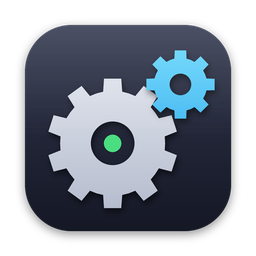

<p align="center"></p>

# LaunchWarden

See and control **everything** that starts with your Mac — not just what *System Settings › General › Login Items & Extensions* chooses to show you.

- **One list for every source**: user and global LaunchAgents, LaunchDaemons, agents/daemons/login items embedded in apps, and the Background Task Management (BTM) database that System Settings reads.
- **Real state**: running (with PID), loaded, disabled or orphaned, read live from `launchd`.
- **Real target**: the actual executable or script behind each item (even `/bin/sh some-script.sh`), its parent app, its plist.
- **Signature check**: Apple, Developer ID (with Team ID) or unsigned.
- **Actions**: show in Finder, copy path, enable/disable, and remove — removal moves the plist to a quarantine instead of deleting it.
- **Quarantine**: every removed item keeps its original location, owner and permissions; restore it in one click, move it to the Trash, delete it permanently, or empty the whole quarantine.
- Icons and names like System Settings, English and French interface (follows your system language).
- Zoomable interface: ⌘+ / ⌘− / ⌘0.

### Processes view (Activity Monitor–style)

- Every running process with CPU, memory, user, signature and **the launchd job that started it** — jump straight to the startup item that keeps it alive.
- Flat list or parent/child **process tree**; filters (mine, third-party, launchd jobs, unsigned); plain or **regular-expression** search.
- **New** processes are highlighted in green and **exited** ones stay visible in red for a few seconds.
- Per-process X-ray: arguments, environment, open files, loaded code, network connections, threads, memory footprint.
- **CPU and memory history charts**, exportable as CSV or JSON.
- **Multi-selection** to quit or force quit several processes at once (one administrator prompt for root processes); pause updates (⇧⌘P) so rows stop moving while you select.
- Processes of other users (root daemons): full details on demand with an administrator password.

## Download

**[⬇︎ Download LaunchWarden 0.4 (DMG)](https://github.com/blckdvc/LauchWarden/raw/main/dist/LaunchWarden-0.4.dmg)** — open it and drag LaunchWarden into Applications.

SHA-256: `8c7bd88f098280e02db250cd3628d4f0b5c8a32317d5db2f1c36d6d9cd83ae1c`

**Requires macOS 26 (Tahoe) on Apple silicon.**

### First launch

The app is not notarized (no paid Apple developer account), so macOS blocks it once:

1. Double-click LaunchWarden (it will be blocked).
2. Go to **System Settings › Privacy & Security**, scroll down and click **Open Anyway**.

If macOS says the app is "damaged", run this once in Terminal:

```
xattr -dr com.apple.quarantine /Applications/LaunchWarden.app
```

To see the full BTM database (what System Settings groups by developer), click the lock button and enter your administrator password.

## Changelog

- **0.4** — Processes view: launchd origin, process tree, regex search, new/exited highlighting, CPU/memory history with CSV/JSON export, per-process X-ray, multi-selection quit/force quit.
- **0.3** — UI zoom (⌘+ / ⌘− / ⌘0, remembered between launches).
- **0.2** — Quarantine section: one-click restore (original owner/permissions, re-enable, reload), delete permanently, empty quarantine, "Restore To" for older entries.
- **0.1** — First release.

## Support

by **blckdvc** — free to use. If you feel like it, buy me a few tokens:

[](https://paypal.me/lbenh)
